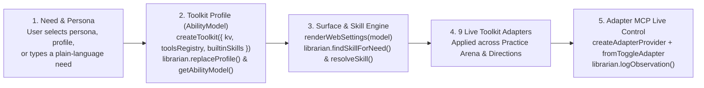

# Rehearse the Journey (Kioo Companion)
### Problem Statement 6 · Cognitive, Neurodivergent & Psychosocial Accessibility

**A self-paced AI rehearsal and sensory journey-planning companion built on the AI for Accessibility Toolkit.**

- **Event:** AI for Accessibility Hackathon · Sat 7 November 2026 · Senses Hub, Nairobi
- **Team 6:** Austin Obimbo · Gathoni Karume · Bakhoya Audry Imbukwa · John Mokaya · Vincent Mutwiri
- **Stack:** AI for Accessibility Toolkit (`toolkit/`, `tools/adapters/`, `toolkit/adapter-mcp/`) · Pipecat WebRTC (`FlowEngine`, `MultiAgentBus`) · React 18 + TypeScript + Three.js (R3F) · Google Maps Routes v2 & Places · Gemini

---

## 1. The Problem We Are Solving

> *"How might we adapt a short virtual rehearsal of a Nairobi journey or service visit to a person’s access preferences, so they can practise at their own pace and exit whenever they choose?"*

### Why Everyday Nairobi Journeys Can Feel Overwhelming
- **Unpredictable scripts & sensory load:** Boarding a Route 46 matatu in the CBD, checking in at a hospital reception desk, or queueing at a Huduma Centre counter involves rapid turn-taking, background noise (`70+ dB`), and sudden plan changes.
- **No safe way to rehearse in advance:** Maps show streets, not *what to say*, *how much the off-peak matatu fare is*, *when the quietest visiting hours are*, or *how to handle a sudden room change*.
- **Loss of control in standard AI voice apps:** Auto-on microphones, fast speech, un-gated step transitions, and moving visuals increase anxiety rather than reducing it.

---

## 2. Our Solution: Kioo Companion ("Soft Mirror")

A calm, two-part rehearsal workspace where the person is **100% in control**:

| Experience | What the Person Can Do |
| :--- | :--- |
| **1. Practice Arena** | Rehearse real-world conversations step-by-step with **two 3D companions on stage** (**Receptionist Joy / Conductor Otieno / Officer Wanjiku / Passerby Maina** + fellow visitor **Amani**), with a live **Interactive StoryCard & Practice Map** right beside them. |
| **2. Get Directions & Sensory Preview** | Preview the real route on **Leaflet + Google Maps Routes v2**, see **Nairobi Matatu Saccos & KES fares**, copy the exact **Kiswahili conductor phrase**, and check **quiet hours, crowd busyness, noise dB, live weather, and landmarks**. |
| **3. Persistent Decompress (`CalmMe`)** | One-click grounding button in the top bar that immediately pauses rehearsal audio and speaks Kenyan **Swahili/Sheng affirmations** + a slow count from **Moja (1)** to **Tano (5)**. |
| **4. 100% Approval-Gated Control** | Microphone starts **OFF**; typing and speaking share one deterministic Flow; every step advance (`go_to_step`), checklist save (`save_checklist`), and camera action (`enable_camera`) requires explicit **Approve / Deny**. |

---

## 3. How We Used the AI for Accessibility Toolkit

We embedded the repository's **AI for Accessibility Toolkit** across both **Practice Arena** and **Get Directions** (`apps/rehearse-journey/client/src/rehearsalToolkit.ts`):

- **Single Source of Truth:** Changing a profile preset, matching a skill, or toggling an adapter in **Get Directions** persists in `rehearsalToolkit.librarian` (`localStorage` KV port) and automatically carries over into **Practice Arena**.

---

## 4. Toolkit Profiles (`AbilityModel`) & Co-Design Personas

### Three Co-Design Persona Workspaces (Top Switcher Bar)
1. **🌿 Zawadi (Sensory Sanctuary & Anxiety-First):**
   - Freezes 3D mascot animations (`frameloop="demand"`), pauses auto-timers, pre-selects **Level 1 (Easy Start)**, and promotes the **Sensory & Quiet-Hours Readiness Banner** above route maps.
2. **📖 Kamau (Structured Focus, Dyslexia & Neurodivergent):**
   - Activates **Bionic Reading** word-prefix anchors, **Plainer Words**, **Bigger Click Targets (44px+)**, numbered 3-step workspace badges, and **1-Tap Starter Phrase Chips** in the Practice Arena.
3. **✨ Baraka (Standard Explorer):**
   - Full animated 3D duo stage, all 4 complexity levels, and on-demand toolkit controls.

### Five `AbilityModel` Profile Presets in Settings (`librarian.replaceProfile`)
- **`standard`** (Default) · **`sensory-calm`** (`sensory`, `cognitive`) · **`low-vision-audio`** (`vision`, `reading`) · **`reading-focus`** (`reading`, `cognitive`) · **`motor-targets`** (`motor`, `largeTargets: true`)

---

## 5. Toolkit Skills (`SKILL.md` Playbooks) & 9 Active Adapters

### 4 Built-In Toolkit Skills (`librarian.resolveSkill` & `librarian.findSkillForNeed`)
Users can type a need in their own words (e.g., *"crowded matatu"* or *"read steps aloud"*) or click a skill card to deterministically compile and enable a multi-adapter recipe:

1. **⚡ Calm Commute & Matatu Navigator:** `sensory-calm` + `simplify-text` + `motion-reducer` + `stop-auto-advance`
2. **⚡ Audio-First Landmark & Step Reader:** `read-aloud` + `big-targets` + `simplify-text`
3. **⚡ Dyslexia & Focus Reading Kit:** `bionic-reading` + `reading-ruler` + `simplify-text`
4. **⚡ Calm Rehearsal Pace:** `stop-auto-advance` + `motion-reducer` + `big-targets` + `simplify-text`

---

## 6. All 9 Toolkit Adapters Wired in Practice Arena & Directions

| # | Adapter ID | Toolkit Module | Effect in **Get Directions** | Effect in **Practice Arena** |
| :- | :--- | :--- | :--- | :--- |
| 1 | `read-aloud` | `tools/adapters/read-aloud.js` | Speaks route summary, current step, Matatu Sacco fare & conductor phrase | Speaks scenario status, step expectations, and latest Joy/Amani turn |
| 2 | `simplify-text` | `simplifyDirectionInstruction` / `simplifyStepText` | Rewrites compass bearings (*"Head northeast…"*) into plain landmark steps | Rewrites step cards & expectations in plain language with *"Show original"* toggle |
| 3 | `stop-auto-advance` | `tools/adapters/stop-auto-advance.js` | Holds still any timed UI transitions | Stops auto-advancing UI while preserving WebRTC companion voice (`handBackBotAudio`) |
| 4 | `motion-reducer` | `tools/adapters/motion-reducer.js` | Disables CSS transitions and animations | Switches 3D Three.js mascots & audio visualizer to static rendering |
| 5 | `sensory-calm` | `SensoryCalmAdapter` (`rehearsalToolkit.ts`) | Promotes **🌿 Sensory-Calm Navigation** banner with quiet hours & noise dB above map | Applies low-stimulation `body.ai4a11y-sensory-calm` palette |
| 6 | `big-targets` | `tools/adapters/big-targets.js` | Enlarges route chips, step buttons & inputs to $\ge 44\times44\text{px}$ (WCAG 2.5.8) | Enlarges Pause, Exit, Mic, and StoryCard navigation buttons |
| 7 | `dark-mode` | `tools/adapters/dark-mode.js` | High-contrast dark theme while keeping Leaflet map & photos un-inverted | High-contrast dark theme while keeping 3D mascot canvases un-inverted |
| 8 | `reading-ruler` | `tools/adapters/reading-ruler.js` | Horizontal cursor-tracking highlight band across route steps & Sacco cards | Cursor-tracking highlight band across dialogue bubbles & StoryCard slides |
| 9 | `bionic-reading` | `tools/adapters/bionic-reading.js` | Bolds word prefixes (40%) across route instructions & landmarks | Bolds word prefixes in static guidance while skipping live ARIA regions |

---

## 7. Practice Arena & Pipecat v1.1 Architecture

### Deterministic State Machine (`bot/flow_config.py`, `bot/flow_engine.py`, `bot/bot.py`)
- **4 Nairobi Scenarios:**
  1. **Hospital Reception** (*Receptionist Joy* & *Visitor Amani*)
  2. **Matatu Stage · Route 46** (*Conductor Otieno* & *Passenger Amani*)
  3. **Government Service Desk** (*Officer Wanjiku* & *Citizen Amani*)
  4. **Asking for Directions** (*Passerby Maina* & *Shopkeeper Amani*)
- **4 Progressive Chaos Levels:**
  - **Level 1 (Easy Start):** Predictable 1-on-1 greeting, card check, and waiting-area direction.
  - **Level 2 (Everyday Practice):** Department / payment choice follow-ups.
  - **Level 3 (Handling Changes):** Real-time diversion branches (e.g., Waiting Area B moved to Room 4; Stage 3 roadworks diversion to Roundabout Stage; ticket printer outage to Counter 5).
  - **Level 4 (Busy Environment):** `MultiAgentBus` handoff (`Joy ↔ Amani`) + parallel fan-out overlap.
- **Ask for Clarity Mode (`bot/clarity.py`):**
  - Configurable `20%` / `40%` / `60%` intentional ambiguity so users can practise asking clarifying questions in English, Kiswahili, or Sheng with a non-judgmental reflection summary.

---

## 8. Interactive StoryCards, Real Maps & Sensory Forecasting

### Side-by-Side StoryCard in Practice Arena (`StoryCard.tsx`, `stories.tsx`)
- Always visible alongside Joy & Amani in the Practice Arena right-hand rail.
- **3-Layer Visual Grounding:**
  1. **Fictional SVG Floor Plans:** Clear spatial layout of Reception, Waiting Area B, Room 4, Counter 3/5, and Stage 1–3.
  2. **Live Google Maps Routes API (v2) Overlay (`bot/maps.py`):** Computes real Nairobi polylines off the critical path (`story_route` RTVI event) and renders them in an interactive Leaflet map.
  3. **Async Gemini Storybook Illustrations (`bot/image_gen.py`):** Generates soft-mirror palette illustrations via `gemini-3.1-flash-image` off the critical path (`story_image` RTVI event) with an 8s timeout so conversation never blocks.

### Get Directions & Nairobi Matatu Sacco Intelligence (`Directions.tsx`)
- **Matatu Sacco & Fare Cards:** Super Metro, 2NK, Citi Hoppa, KBS; Boarding & Alighting stages; Off-Peak vs. Peak KES fares; M-Pesa/Cash notes; and exact Kiswahili conductor phrases.
- **Sensory & Weather Snapshot:** Live Open-Meteo temperature/rain/wind + crowd busyness + quiet hours + dB noise estimate.

---

## 9. Toolkit Issues Found & Logged (`Project/toolkit-issues.md`)

While integrating the toolkit, **Vincent and Imbukwa** reproduced, mitigated, and logged **5 genuine toolkit issues**:

| ID | Area | Issue Found | Severity | Our Mitigation in Kioo Companion |
| :--- | :--- | :--- | :--- | :--- |
| **TKI-001** | `adapters/stop-auto-advance` | `StopAutoAdvance.enable()` pauses every `<audio>` element on the page, muting Pipecat's live WebRTC companion voice (`PipecatClientAudio`). | **Major** | Implemented `enableStopAutoAdvance()` + `handBackBotAudio()` in `toolkitAdapters.ts` to untrack and resume WebRTC `<audio>` elements. |
| **TKI-002** | `adapters/motion-reducer` | `MotionReducer.enable()` stops CSS/WAAPI animations but has no hook for stopping Three.js / WebGL `requestAnimationFrame` render loops. | **Minor** | Bridged `reduceMotion \|\| stopAuto` into `JoyMascot.tsx` and `JoyScene.tsx` (`frameloop="demand"`), verified by pixel-diff Playwright tests. |
| **TKI-003** | `adapters / TypeScript` | Browser adapters in `tools/adapters/*.js` ship without `.d.ts` TypeScript declarations, failing strict `tsc` builds with `TS7016`. | **Minor** | Isolated single-line `@ts-expect-error` imports inside `toolkitAdapters.ts` and `rehearsalToolkit.ts` with typed TypeScript wrappers. |
| **TKI-004** | `core` (`adapter-mcp`) | `createAdapterProvider` throws `AdapterMcpError` unless `supportedPlatforms`, `platform: detectBrowserPlatform()`, and `surfaces: ['web']` are explicitly passed. | **Minor** | Supplied full `detectBrowserPlatform()` advertisement and per-adapter `targets` callbacks in `rehearsalToolkit.ts`. |
| **TKI-005** | `core` (`AbilityModel`) | `librarian.replaceProfile()` + `getAbilityModel()` returns an empty `supportAreas: []` array when needs are nested under `profile.fields`. | **Minor** | Added non-empty array check (`model.supportAreas?.length ? model.supportAreas : preset.supportAreas`) in `rehearsalToolkit.ts`. |

---

## 10. Live Showcase Walkthrough (3-Minute Stage Demo)

### Step 1 · Persona & Toolkit Profile Selection (30s)
- Open **`http://localhost:3000`**. Point out the top **Co-Designer Persona Switcher** (**Zawadi**, **Kamau**, **Baraka**).
- Switch to **🌿 Zawadi (Sensory Sanctuary)** → show how 3D motion freezes immediately, the green Sensory Sanctuary banner appears, and `Sensory & Calm Commute` is active in the Toolkit.
- Switch to **📖 Kamau (Structured Focus)** → show the numbered 3-step cards and **Bionic Reading** + **Big Targets (44px+)**.

### Step 2 · Get Directions & Sensory Journey Preview (60s)
- Click **Get Directions** → select **Mbagathi Hospital, Nairobi** → click **Find route**.
- Showcase:
  1. **🌿 Sensory-Calm Navigation Banner** at the top (quiet hours `10:00 AM – 12:00 PM`, noise estimate, comfort tip).
  2. **Interactive Leaflet Map + Step-by-Step Navigator** (with **Plainer Words** rewriting navigation instructions).
  3. **Matatu Sacco & Fare Card** (*Route 34 / 125 · Citi Hoppa / Mbagathi Sacco*, off-peak KES fare, and *“Shukisha Mbagathi Gate, tafadhali”*).
  4. Open **⚙ Settings** → click **🔊 Read page aloud** or apply the **⚡ Dyslexia & Focus Reading Kit** skill (`Reading Ruler` appears).

---

## 10. Live Showcase Walkthrough (Continued)

### Step 3 · Practice Arena & Interactive StoryCard (60s)
- Click **Rehearse this trip with Conductor Otieno** (or return Home → **Practice Arena** → **Hospital Reception**).
- Showcase on the Practice Arena screen:
  1. **Two-Mascot 3D Stage:** **Receptionist Joy** at her desk on the left and **Visitor Amani** on the right, with live speech bubbles underneath each speaker.
  2. **Interactive StoryCard & Practice Map** in the right-hand rail (*Finding Waiting Area B* — page through Slide 1 Intro → Slide 2 Floor-Plan / Real Route Map → Slide 3 Recap).
  3. **1-Tap Starter Phrase Chips** (or type/speak *"Hello Joy, I am here for my pretend clinic appointment"*).
  4. **Deterministic Approval Gate:** On Step 2 (*Pretend clinic card check*), reply *"Yes, here is my pretend card"* → show the **Action approval required (`go_to_step`)** card → click **Deny (stay put)** to prove the bot never advances without permission, then click **Approve** to advance to Step 3.

### Step 4 · Decompress Grounding Modal (30s)
- Click **Decompress** in the top-right corner at any moment → show that active rehearsal audio pauses immediately and the app speaks calming Kenyan Swahili/Sheng affirmations with a slow count from **Moja (1)** to **Tano (5)**.

---

## 11. Alignment with Hackathon Judging Criteria

| Judging Criterion | Weight | How Rehearse the Journey Delivers |
| :--- | :---: | :--- |
| **1. Fit to the problem & the person it serves** | **30%** | Co-designed around Nairobi cognitive, sensory, and psychosocial access needs: predictable step ladder, Kenyan matatu Sacco/fare/phrase grounding, sensory crowd/noise/quiet-hour forecasts, **Ask for Clarity**, and **Decompress** Swahili/Sheng affirmations. |
| **2. Working solution, shown by the co-designer** | **30%** | Self-paced, keyboard- and screen-reader-accessible web app (`WCAG 2.5.8` 44px+ targets, 1-tap starter chips, mic-off start, guaranteed typed + spoken parity, 20-case Approval Gate). Verified by 6 automated test suites. |
| **3. Use of the toolkit & contribution back** | **20%** | Embeds `createToolkit` (`Librarian` + `Datastore`), 5 `AbilityModel` profile presets, 4 `SKILL.md` playbooks (`resolveSkill`), 9 active toolkit adapters across both Directions & Practice Arena, `AdapterProvider` MCP live control, and **5 reproducible toolkit issues (`TKI-001`–`TKI-005`)** logged in `Project/toolkit-issues.md`. |
| **4. Documentation & potential to continue** | **20%** | Complete architecture docs (`README.md`, `slide.md`, `Project/PRD.md`, spike notes for Flows, Multi-Agent, Multimodal Vision, and React Native bridge in `apps/rehearse-journey/mobile/`). |
