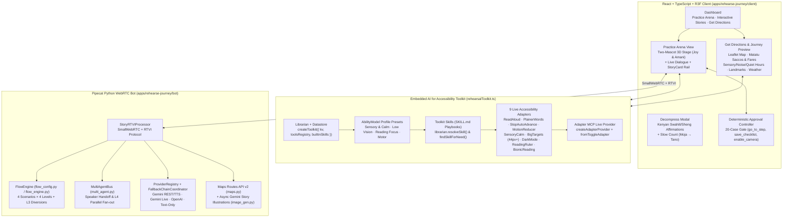

# Rehearse the Journey (Kioo Companion)

**A personalized, self-paced AI rehearsal and sensory journey-planning companion built on the AI for Accessibility Toolkit.**

[](LICENSE)
[](Project/PRD.md)

**Event:** AI for Accessibility Hackathon · Sat Nov 7, 2026 · Senses Hub, Nairobi  
**Team 6:** Austin Obimbo, Gathoni Karume, Bakhoya Audry Imbukwa, John Mokaya, Vincent Mutwiri  
**Built on:** [AI for Accessibility Toolkit (`toolkit/`, `tools/adapters/`, `toolkit/adapter-mcp/`)](toolkit/) + [Pipecat WebRTC (`apps/rehearse-journey/bot/`)](apps/rehearse-journey/bot/) + [React 18 / Three.js / Vite (`apps/rehearse-journey/client/`)](apps/rehearse-journey/client/)

---

## 1. Overview & Problem Statement

For a person with a cognitive, neurodivergent, sensory, or psychosocial disability, everyday Nairobi journeys — navigating a busy matatu stage, checking in at a hospital reception desk, visiting a Huduma Centre counter, or asking a passerby for directions — can feel overwhelming, unpredictable, and stressful.

**Rehearse the Journey (Kioo Companion)** gives people a calm, safe, self-paced space to:
1. **Preview a real journey before setting off (`Get Directions`)** — see the route on a map, know which matatu Sacco to board, check off-peak vs. peak KES fares, learn the exact Kiswahili phrase for the conductor (*“Shukisha hapa, tafadhali”*), preview photos and landmarks, and check live weather, crowd busyness, quiet hours, and noise estimates.
2. **Rehearse the conversation step-by-step (`Practice Arena`)** — practise speaking or typing with friendly 3D companions (**Receptionist Joy**, **Conductor Otieno**, **Officer Wanjiku**, **Passerby Maina**, and fellow visitor **Amani**) across four controllable difficulty levels, with an interactive **StoryCard & Practice Map** beside the mascots.
3. **Stay in 100% control (`Approval Gate`, `Decompress`, & `AI for Accessibility Toolkit`)** — every step-advancing action goes through an explicit **Approve / Deny** gate, the microphone always starts **off**, a persistent **Decompress** button offers grounding Swahili/Sheng affirmations anytime, and the person's **AI for Accessibility Toolkit Profile (`AbilityModel`)**, **Skills (`SKILL.md` playbooks)**, and **9 Accessibility Adapters** adapt both **Directions** and **Practice Arena** automatically.

---

## 2. System Architecture



---

## 3. Key Features

### A. Interactive Role-Play Practice Arena (`Practice Arena`)
- **Two-Mascot 3D Stage (`JoyCenterpiece.tsx`, `JoyScene.tsx`):**
  - Procedural Three.js / React Three Fiber 3D characters (**Receptionist Joy**, **Conductor Otieno**, **Officer Wanjiku**, **Passerby Maina**) on the left and **Visitor/Passenger Amani** (your practice partner) on the right, angled toward each other with live speech bubbles underneath each character.
  - Respects OS `prefers-reduced-motion` and the toolkit's **Reduce Motion** / **Stop Auto-Advance** adapters by switching the WebGL canvas to `frameloop="demand"` static rendering without cutting off audio.
- **4 Everyday Nairobi Scenarios × 4 Complexity Levels (`flow_config.py`, `flow_engine.py`):**
  1. **Hospital Reception** (*Receptionist Joy* & *Patient Amani*)
  2. **Matatu Stage · Route 46** (*Conductor Otieno* & *Passenger Amani*)
  3. **Government Service Desk** (*Officer Wanjiku* & *Citizen Amani*)
  4. **Asking for Directions** (*Passerby Maina* & *Shopkeeper Amani*)
  - **Levels:**
    - **Level 1 · Easy Start:** Short, predictable 4-step conversation flow.
    - **Level 2 · Everyday Practice:** Follow-up questions (e.g., choosing General Clinic vs. Dental Desk, M-Pesa vs. cash).
    - **Level 3 · Handling Changes:** Practices unexpected real-world changes calmly (e.g., Waiting Area B relocated to Room 4; Stage 3 closed for roadworks → Roundabout Stage diversion; ticket printer outage → Counter 5 paper queue).
    - **Level 4 · Busy Environment:** Multi-agent handoff (`Joy ↔ Amani`) and parallel fan-out where two people speak and the user chooses whom to answer.
- **Interactive StoryCard & Practice Map (`StoryCard.tsx`, `stories.tsx`):**
  - Shown alongside Joy & Amani in the right-hand rail inside the Practice Arena (and browsable standalone from the Dashboard).
  - Manual **Back / Next / Done** paging (never auto-advances), combining plain-language orientation slides, SVG floor plans, live **Google Maps Routes API (v2)** Leaflet routes, and asynchronous **Gemini (`gemini-3.1-flash-image`)** storybook illustrations.
- **Ask for Clarity Mode (`clarity.py`):**
  - Optional toggle (20%, 40%, or 60% frequency) that introduces gentle, realistic missing details so the user can practise asking clarifying questions in English, Kiswahili, or Sheng, with an optional **Need a hint?** prompt.
- **Deterministic 20-Case Approval Controller (`approvalController.ts`, `useApprovalGate.ts`):**
  - Sole authority over step progression (`go_to_step`), checklist persistence (`save_checklist`), and sign-reader camera consent (`enable_camera`). Prompt injection or model requests can never advance a gated step without explicit human approval.

### B. Directions & Sensory Journey Preview (`Get Directions`)
- **Route Overview & Interactive Map (`Directions.tsx`):**
  - Calls **Google Maps Routes API (v2)** to plot the full route on an interactive **Leaflet + OpenStreetMap** map with total distance, driving/matatu time, walking estimate, and step-by-step checkpoints, clearly labelled *"Candidate path — confirm with your co-designer."*
- **Nairobi Matatu Saccos, Stages & Fare Estimator:**
  - Matches corridors (Mbagathi/KNH Upper Hill, CBD/GPO Huduma, Thika Rd/KCA, Westlands) to real Nairobi routes (e.g. Route 7C/46, Route 34/125, Super Metro, 2NK, Citi Hoppa, KBS), showing **Boarding Stage**, **Alighting Stage**, **Off-Peak vs. Peak KES Fares**, payment methods, and **What to say to the conductor** (plus a 1-click button to rehearse the trip with Conductor Otieno).
- **Sensory Estimates & Live Weather:**
  - Combines **Open-Meteo** live weather (temperature, feels-like, humidity, wind, rain probability) with time-of-day crowd busyness (*Calm / Moderate / Busy*), quiet visiting hours, noise level estimates (`~45–75+ dB`), and actionable sensory comfort tips.
- **Visual Place Previews & Landmarks:**
  - Pulls destination photos and nearby landmarks via **Google Places API (New)** with automatic fallback to calm illustrated SVG entrance previews.

### C. Persistent Decompress Grounding Modal (`CalmMe.tsx`)
- Always reachable in the top-right corner (**Decompress**).
- Immediately pauses any active rehearsal audio/mic and guides the user through spoken Kenyan Swahili/Sheng affirmations followed by a calm, unhurried count from **Moja (1)** to **Tano (5)**.

---

## 4. AI for Accessibility Toolkit Integration

Rehearse the Journey is built directly on top of the repository's **AI for Accessibility Toolkit** (`toolkit/`, `tools/adapters/`, `toolkit/adapter-mcp/`), wired in [`apps/rehearse-journey/client/src/rehearsalToolkit.ts`](apps/rehearse-journey/client/src/rehearsalToolkit.ts) and [`ToolkitProfileAndSkillsPanel.tsx`](apps/rehearse-journey/client/src/presentation/ToolkitProfileAndSkillsPanel.tsx):

1. **Embedded Librarian & Datastore Core (`createToolkit` from `toolkit/index.js`):**
   - Persists the user's profile and episodic observations in browser storage (`rtj_toolkit_kv:*`), maps `AbilityModel` needs to web settings via `renderWebSettings` (`toolkit/surfaces/web.js`), and logs adapter/skill actions via `librarian.logObservation(...)`.
2. **5 Built-In `AbilityModel` Profile Presets:**
   - **Standard Profile (Default)**
   - **Sensory & Calm Commute** (`sensory`, `cognitive` → enables *Plainer Words*, *Stop Auto-Advance*, *Reduce Motion*, and *Sensory-Calm Mode*)
   - **Low Vision & Audio Guide** (`vision`, `reading` → enables *Read Page Aloud*, *Bigger Click Targets 44px+*, and *High Contrast / Dark Mode*)
   - **Dyslexia & Focus Reading** (`reading`, `cognitive` → enables *Plainer Words*, *Reading Ruler*, and *Bionic Reading*)
   - **Motor & Touch Comfort** (`motor` → enables *Bigger Click Targets 44px+*, *Stop Auto-Advance*, and *Reduce Motion*)
3. **4 Composable Toolkit Skills (`SKILL.md` Playbooks via `librarian.resolveSkill` & `librarian.findSkillForNeed`):**
   - **⚡ Calm Commute & Matatu Navigator** (`sensory-calm` + `simplify-text` + `motion-reducer` + `stop-auto-advance`)
   - **⚡ Audio-First Landmark & Step Reader** (`read-aloud` + `big-targets` + `simplify-text`)
   - **⚡ Dyslexia & Focus Reading Kit** (`bionic-reading` + `reading-ruler` + `simplify-text`)
   - **⚡ Calm Rehearsal Pace** (`stop-auto-advance` + `motion-reducer` + `big-targets` + `simplify-text`)
4. **9 Active Toolkit Adapters Across Both `Directions` & `Practice Arena`:**
   - `ReadAloud` (`tools/adapters/read-aloud.js`)
   - `PlainerWords` (`simplifyStepText` & `simplifyDirectionInstruction`)
   - `StopAutoAdvance` (`tools/adapters/stop-auto-advance.js` with WebRTC voice preservation)
   - `MotionReducer` (`tools/adapters/motion-reducer.js` + 3D canvas `still` bridge)
   - `SensoryCalmAdapter` (promotes quiet-hours & low-noise banner above the route map)
   - `BigTargets` (`tools/adapters/big-targets.js` — WCAG 2.5.8 $\ge 44\times 44\text{px}$ targets)
   - `DarkMode` (`tools/adapters/dark-mode.js` — high-contrast dark theme preserving maps, photos, and 3D canvases)
   - `ReadingRuler` (`tools/adapters/reading-ruler.js` — cursor-following horizontal reading band)
   - `BionicReading` (`tools/adapters/bionic-reading.js` — word-prefix bolding for saccade anchoring)
5. **Adapter MCP Live Control (`toolkit/adapter-mcp/index.js`):**
   - Exports all 9 adapters through `createAdapterProvider` + `fromToggleAdapter` + `defineDescriptor` (`appId: 'rehearse-journey'`) and connects to a live Toolkit server when `VITE_TOOLKIT_URL` and `VITE_TOOLKIT_TOKEN` are configured.

---

## 5. Quick Start

### Prerequisites
- **Node.js 20+** and **pnpm**
- **Python 3.12+** and **uv**

### 1. Start the Pipecat Bot Backend (Terminal 1)
```bash
cd apps/rehearse-journey/bot
uv sync
uv run bot.py
# Listening on http://localhost:7860
```

Configure `apps/rehearse-journey/bot/.env` with your provider keys (never commit `.env`):
```env
GOOGLE_API_KEY=your_gemini_key
OPENAI_API_KEY=your_openai_key
maps_api=your_google_maps_routes_and_places_key
USE_GEMINI_LIVE=0
```
*(If no voice provider key is set or audio is turned off in the user's profile, the bot automatically falls back to `DeterministicTextOnlyLLMProcessor` so typed rehearsal and Flow progression always work offline.)*

### 2. Start the React + Vite Client (Terminal 2)
```bash
cd apps/rehearse-journey/client
pnpm install
pnpm dev --port 3000
# Open http://localhost:3000 in Chrome
```

Optional client environment (`apps/rehearse-journey/client/.env.local`):
```env
VITE_MAPS_API_KEY=your_google_maps_routes_and_places_key
VITE_TOOLKIT_URL=http://localhost:8080
VITE_TOOLKIT_TOKEN=aat_your_default_token
```

---

## 6. Verification & Automated Tests

```bash
# 1. Backend v1.1 Sprints & Flow/Approval/Provider Regression Suite
./apps/rehearse-journey/bot/.venv/bin/python3 apps/rehearse-journey/bot/test_v11_sprints.py

# 2. Client TypeScript + Production Bundle Check
pnpm --dir apps/rehearse-journey/client build

# 3. Playwright Browser Regressions (with Vite running on http://127.0.0.1:3000)
python3 apps/rehearse-journey/client/test/story-card.py http://127.0.0.1:3000
python3 apps/rehearse-journey/client/test/mascot-dialogue.py http://127.0.0.1:3000
python3 apps/rehearse-journey/client/test/rehearsal-integration.py http://127.0.0.1:3000
python3 apps/rehearse-journey/client/test/session-settings.py http://127.0.0.1:3000
python3 apps/rehearse-journey/client/test/s45-accessibility.py http://127.0.0.1:3000
```

---

## 7. Toolkit Issues Logged (`Project/toolkit-issues.md`)

As part of building on the AI for Accessibility Toolkit and contributing back, we logged **5 reproducible toolkit integration issues** in [`Project/toolkit-issues.md`](Project/toolkit-issues.md):

| ID | Area | Summary | Severity | Status |
|---|---|---|---|---|
| **TKI-001** | `adapters/stop-auto-advance` | `StopAutoAdvance.enable()` pauses all `<audio>` elements, muting live conversational WebRTC voice output | `major` | `open` |
| **TKI-002** | `adapters/motion-reducer` | Canvas animation needs a separate app-level reduced-motion bridge | `minor` | `open` |
| **TKI-003** | `adapters / TypeScript` | Browser adapter imports in `tools/adapters/` have no TypeScript `.d.ts` declarations (`TS7016`) | `minor` | `open` |
| **TKI-004** | `core` | `createAdapterProvider` rejects `catalogDescriptor` defaults and skill snippet `application` shape without `supportedPlatforms`, `platform`, and `surfaces` | `minor` | `open` |
| **TKI-005** | `core` | `librarian.replaceProfile()` + `getAbilityModel()` returns an empty `supportAreas: []` array when profile fields are nested under `profile.fields` | `minor` | `open` |

---

## 8. Repository Layout

```text
├── apps/rehearse-journey/         # Rehearse the Journey (Kioo Companion) application
│   ├── bot/                       # Python Pipecat WebRTC bot, FlowEngine, MultiAgentBus, Maps & Image Gen
│   ├── client/                    # React 18 + TypeScript + R3F 3D Mascots + Directions + Toolkit integration
│   └── mobile/                    # React Native companion screen & native toolkit adapter bridge
├── Project/                       # Hackathon PRD, Sprint Plans, Spike Notes, Approval Cases & Toolkit Issues
│   ├── PRD.md                     # Product Requirements Document (Problem Statement 6)
│   ├── Pipecat-Nov7-sprint-plan.md# Sprint execution plan & architecture notes
│   ├── toolkit-issues.md          # Logged AI for Accessibility Toolkit issues (TKI-001 – TKI-005)
│   └── approval-cases.md          # 20 deterministic approval & safety test cases (A01–A20)
├── toolkit/                       # AI for Accessibility Toolkit core (Librarian, Datastore, AbilityModel, Skills, Surfaces, Adapter MCP)
├── tools/adapters/                # Browser accessibility adapters (ReadAloud, BigTargets, DarkMode, ReadingRuler, BionicReading, etc.)
├── server/                        # Hosted HTTP & Adapter MCP registry service for the toolkit
└── docs/                          # Toolkit architecture, glossary, and design documentation
```

---

## License

Licensed under Apache 2.0 ([LICENSE](LICENSE)). Built upon the [AI for Accessibility Toolkit](docs/HOW-THIS-WAS-BUILT.md).
